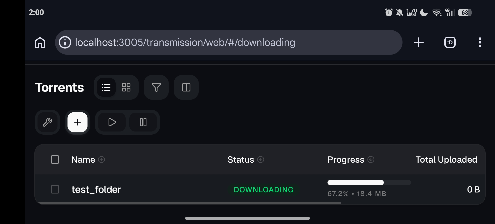

# UTransmission

A Fast, Easy and Free BitTorrent Client.

  
  
  

## About

UTransmission does **not contain any web UI code**.

It simply downloads and sets up **Transmission**, then installs the
[Transmission Next UI](https://github.com/hisproc/transmission-next-ui)
project on top of it to provide a modern, mobile-friendly web interface.

The web interface is provided entirely by the external **Transmission Next UI**
project and is not included in UTransmission's source code.

## Web UI

The UI is downloaded from the latest release:

https://github.com/hisproc/transmission-next-ui/releases/latest/download/release.zip

## Credits

- [Transmission](https://transmissionbt.com/) — BitTorrent client
- [Transmission Next UI](https://github.com/hisproc/transmission-next-ui) — Web interface